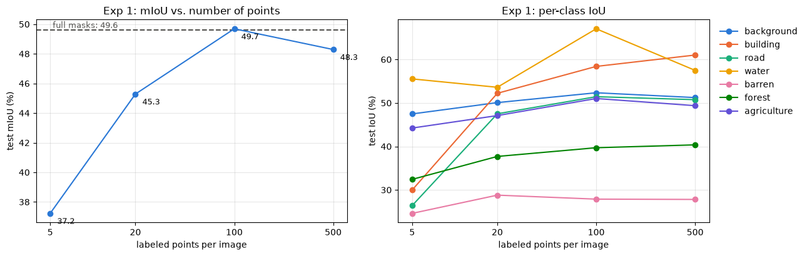
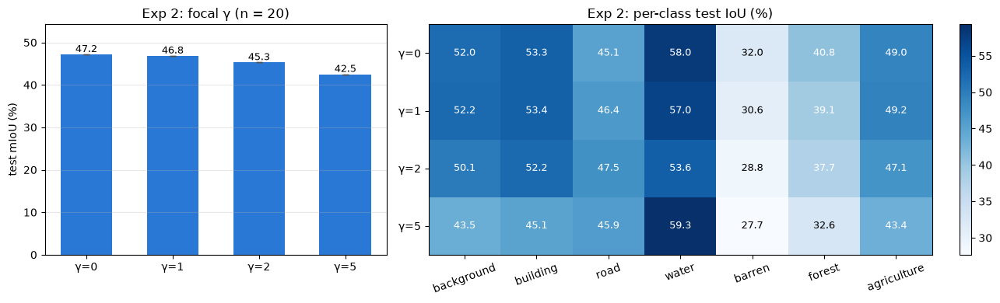
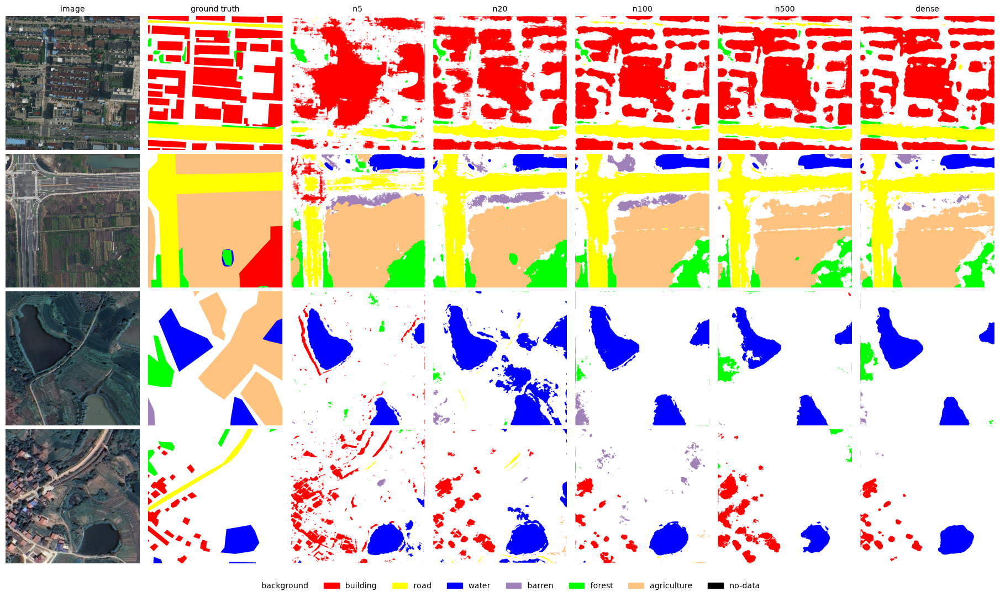

# Point-supervised segmentation on LoveDA

Training a land-cover segmentation model from a few clicked points per image instead of full masks, using a partial (focal) cross-entropy loss.

**Main result:** with 100 random points per 1024×1024 image (0.01% of the pixels), a U-Net reaches **49.7% test mIoU**, the same as training on full masks (49.6%). Plain partial cross-entropy worked better than the focal version.

The full write-up is in [`report/Point_Supervised_Segmentation_Report.pdf`](report/Point_Supervised_Segmentation_Report.pdf).

## What's in the repo

| File | What it is |
|---|---|
| [`point_supervised_segmentation_local.ipynb`](point_supervised_segmentation_local.ipynb) | The whole project in one notebook: data, loss, point sampling, training, experiments and results, with all outputs |
| [`report/`](report/) | Technical report (PDF) |
| [`figures/`](figures/) | Figures from the notebook, used below |
| [`requirements.txt`](requirements.txt) | Python packages |

## Method in short

- **Loss.** Focal loss computed only at labeled pixels and divided by the number of labeled pixels:
  `pCE = Σ FL(pred, GT) · M / Σ M`, with `FL = −(1 − p)^γ · log(p)` and `M = 1` at labeled pixels.
  With γ = 0 this is plain partial cross-entropy, and it matches PyTorch's `cross_entropy(..., ignore_index=255)` exactly (checked in the notebook).
- **Data.** [LoveDA](https://zenodo.org/records/5706578): 1024×1024 aerial images at 0.3 m, 7 classes, urban and rural scenes. The official train set is split 90/10 into train (2,269) and validation (253); the official validation set (1,669) is used as the test set, because the official test labels are not public.
- **Point labels.** For each training image, n random pixels keep their label and everything else is marked unlabeled. Points are sampled once (seed 0), saved, and never re-sampled during training.
- **Model and training.** U-Net with an ImageNet-pretrained ResNet-34 encoder (segmentation-models-pytorch), random 512×512 crops with flips and rotations, AdamW (lr 3e-4, cosine schedule), 8,000 iterations × batch 8 for every run, bf16 mixed precision.
- **Evaluation.** Trained on points, tested on the full masks of the test set at full resolution. mIoU from one confusion matrix over the whole test set, using the last checkpoint (no dense labels used for model selection).

## Results

All numbers are test-set results from a single seed.

### Experiment 1: how many points per image?

| Points per image | Labeled pixels | mIoU | OA |
|---|---|---|---|
| 5 | 0.0005% | 37.2 | 60.3 |
| 20 | 0.002% | 45.3 | 64.9 |
| **100** | **0.01%** | **49.7** | **68.2** |
| 500 | 0.05% | 48.3 | 67.0 |
| Full masks | 100% | 49.6 | 68.2 |



Most of the gain comes between 5 and 20 points, and from 100 points on the model matches full masks. With very few points, buildings and roads suffer most.

### Experiment 2: does the focal term help? (20 points per image)

| γ | mIoU | OA |
|---|---|---|
| **0 (plain partial CE)** | **47.2** | **66.7** |
| 1 | 46.8 | 66.5 |
| 2 | 45.3 | 64.9 |
| 5 | 42.5 | 60.5 |



The higher γ, the worse the result. With only a few points per image every labeled pixel matters, and the focal term down-weights exactly the points the model already gets right.

### Example predictions



## How to run

1. Create an environment (tested with Python 3.12) and install PyTorch with CUDA from [pytorch.org](https://pytorch.org/get-started/locally/), then:
   ```bash
   pip install -r requirements.txt
   ```
2. Download `Train.zip` and `Val.zip` from [Zenodo record 5706578](https://zenodo.org/records/5706578) into a `data/` folder next to the notebook. The notebook checks their MD5, extracts them, and can also try to download them itself.
3. Open the notebook and run all cells. It builds the splits, samples the point labels, trains the 8 models and makes the tables and figures. Results are saved in `outputs/`. Re-running skips finished runs and resumes interrupted ones.

Training took about 36 minutes per run on an RTX A2000 8 GB laptop GPU. The notebook writes a small `loveda_ds.py` file next to itself so that DataLoader workers also work on Windows.

## Notes

- Each setting was run once (seed 0), so differences of 1–2 mIoU may be noise. Set `SEEDS = [0, 1, 2]` in the notebook to repeat with more seeds.
- The 500-point run crashed at the end (out of RAM on Windows) and was resumed from its checkpoint at iteration 6,000. The fix and the continuation are in the notebook.
- LoveDA may be used for academic purposes only. The dataset is not included in this repository.
